<!-- The Daily Commit: printed by press/print.py on 27 October 2026, 23:46 IST. Edit press/content.py, not this file. -->

<a href="https://www.anirbandas.com"><picture><source media="(max-width: 640px) and (prefers-color-scheme:dark)" srcset="edition/mobile/masthead-dark.svg"><source media="(max-width: 640px)" srcset="edition/mobile/masthead-light.svg"><source media="(prefers-color-scheme: dark)" srcset="edition/masthead-dark.svg"></picture></a>

<a href="https://www.anirbandas.com"><picture><source media="(max-width: 640px) and (prefers-color-scheme:dark)" srcset="edition/mobile/nav-0-dark.svg"><source media="(max-width: 640px)" srcset="edition/mobile/nav-0-light.svg"><source media="(prefers-color-scheme: dark)" srcset="edition/nav-0-dark.svg"></picture></a><a href="https://www.anirbandas.com/projects"><picture><source media="(max-width: 640px) and (prefers-color-scheme:dark)" srcset="edition/mobile/nav-1-dark.svg"><source media="(max-width: 640px)" srcset="edition/mobile/nav-1-light.svg"><source media="(prefers-color-scheme: dark)" srcset="edition/nav-1-dark.svg"></picture></a><a href="https://www.anirbandas.com/about"><picture><source media="(max-width: 640px) and (prefers-color-scheme:dark)" srcset="edition/mobile/nav-2-dark.svg"><source media="(max-width: 640px)" srcset="edition/mobile/nav-2-light.svg"><source media="(prefers-color-scheme: dark)" srcset="edition/nav-2-dark.svg"></picture></a><a href="https://www.linkedin.com/in/anirban12d"><picture><source media="(max-width: 640px) and (prefers-color-scheme:dark)" srcset="edition/mobile/nav-3-dark.svg"><source media="(max-width: 640px)" srcset="edition/mobile/nav-3-light.svg"><source media="(prefers-color-scheme: dark)" srcset="edition/nav-3-dark.svg"></picture></a><a href="https://twitter.com/anirban12d"><picture><source media="(max-width: 640px) and (prefers-color-scheme:dark)" srcset="edition/mobile/nav-4-dark.svg"><source media="(max-width: 640px)" srcset="edition/mobile/nav-4-light.svg"><source media="(prefers-color-scheme: dark)" srcset="edition/nav-4-dark.svg"></picture></a><a href="https://dev.to/anirban12d"><picture><source media="(max-width: 640px) and (prefers-color-scheme:dark)" srcset="edition/mobile/nav-5-dark.svg"><source media="(max-width: 640px)" srcset="edition/mobile/nav-5-light.svg"><source media="(prefers-color-scheme: dark)" srcset="edition/nav-5-dark.svg"></picture></a><a href="https://medium.com/@anirban12d"><picture><source media="(max-width: 640px) and (prefers-color-scheme:dark)" srcset="edition/mobile/nav-6-dark.svg"><source media="(max-width: 640px)" srcset="edition/mobile/nav-6-light.svg"><source media="(prefers-color-scheme: dark)" srcset="edition/nav-6-dark.svg"></picture></a><a href="mailto:anirbandashere@gmail.com"><picture><source media="(max-width: 640px) and (prefers-color-scheme:dark)" srcset="edition/mobile/nav-7-dark.svg"><source media="(max-width: 640px)" srcset="edition/mobile/nav-7-light.svg"><source media="(prefers-color-scheme: dark)" srcset="edition/nav-7-dark.svg"></picture></a>

<picture><source media="(max-width: 640px) and (prefers-color-scheme:dark)" srcset="edition/mobile/ticker-dark.svg"><source media="(max-width: 640px)" srcset="edition/mobile/ticker-light.svg"><source media="(prefers-color-scheme: dark)" srcset="edition/ticker-dark.svg"></picture>

<a href="https://www.anirbandas.com/about"><picture><source media="(max-width: 640px) and (prefers-color-scheme:dark)" srcset="edition/mobile/lead-dark.svg"><source media="(max-width: 640px)" srcset="edition/mobile/lead-light.svg"><source media="(prefers-color-scheme: dark)" srcset="edition/lead-dark.svg"></picture></a>

<picture><source media="(max-width: 640px) and (prefers-color-scheme:dark)" srcset="edition/mobile/numbers-dark.svg"><source media="(max-width: 640px)" srcset="edition/mobile/numbers-light.svg"><source media="(prefers-color-scheme: dark)" srcset="edition/numbers-dark.svg"></picture>

<picture><source media="(max-width: 640px) and (prefers-color-scheme:dark)" srcset="edition/mobile/work-dark.svg"><source media="(max-width: 640px)" srcset="edition/mobile/work-light.svg"><source media="(prefers-color-scheme: dark)" srcset="edition/work-dark.svg"></picture>

<a href="https://play.google.com/store/apps/details?id=com.txt.launcher"><picture><source media="(max-width: 640px) and (prefers-color-scheme:dark)" srcset="edition/mobile/card-txt-launcher-dark.svg"><source media="(max-width: 640px)" srcset="edition/mobile/card-txt-launcher-light.svg"><source media="(prefers-color-scheme: dark)" srcset="edition/card-txt-launcher-dark.svg"></picture></a> <a href="https://github.com/anirban12d/bluekeys"><picture><source media="(max-width: 640px) and (prefers-color-scheme:dark)" srcset="edition/mobile/card-bluekeys-dark.svg"><source media="(max-width: 640px)" srcset="edition/mobile/card-bluekeys-light.svg"><source media="(prefers-color-scheme: dark)" srcset="edition/card-bluekeys-dark.svg"></picture></a>

<a href="https://github.com/anirban12d/repo-radar"><picture><source media="(max-width: 640px) and (prefers-color-scheme:dark)" srcset="edition/mobile/card-reporadar-dark.svg"><source media="(max-width: 640px)" srcset="edition/mobile/card-reporadar-light.svg"><source media="(prefers-color-scheme: dark)" srcset="edition/card-reporadar-dark.svg"></picture></a> <a href="https://github.com/anirban12d/profile-pulse"><picture><source media="(max-width: 640px) and (prefers-color-scheme:dark)" srcset="edition/mobile/card-profilepulse-dark.svg"><source media="(max-width: 640px)" srcset="edition/mobile/card-profilepulse-light.svg"><source media="(prefers-color-scheme: dark)" srcset="edition/card-profilepulse-dark.svg"></picture></a>

<a href="https://github.com/anirban12d/blogzilla"><picture><source media="(max-width: 640px) and (prefers-color-scheme:dark)" srcset="edition/mobile/card-blogzilla-dark.svg"><source media="(max-width: 640px)" srcset="edition/mobile/card-blogzilla-light.svg"><source media="(prefers-color-scheme: dark)" srcset="edition/card-blogzilla-dark.svg"></picture></a> <a href="https://github.com/anirban12d/Moviez"><picture><source media="(max-width: 640px) and (prefers-color-scheme:dark)" srcset="edition/mobile/card-moviez-dark.svg"><source media="(max-width: 640px)" srcset="edition/mobile/card-moviez-light.svg"><source media="(prefers-color-scheme: dark)" srcset="edition/card-moviez-dark.svg"></picture></a>

<picture><source media="(max-width: 640px) and (prefers-color-scheme:dark)" srcset="edition/mobile/year-dark.svg"><source media="(max-width: 640px)" srcset="edition/mobile/year-light.svg"><source media="(prefers-color-scheme: dark)" srcset="edition/year-dark.svg"></picture>

<picture><source media="(max-width: 640px) and (prefers-color-scheme:dark)" srcset="edition/mobile/markets-dark.svg"><source media="(max-width: 640px)" srcset="edition/mobile/markets-light.svg"><source media="(prefers-color-scheme: dark)" srcset="edition/markets-dark.svg"></picture>

<picture><source media="(max-width: 640px) and (prefers-color-scheme:dark)" srcset="edition/mobile/classifieds-dark.svg"><source media="(max-width: 640px)" srcset="edition/mobile/classifieds-light.svg"><source media="(prefers-color-scheme: dark)" srcset="edition/classifieds-dark.svg"></picture>

<a href="mailto:anirbandashere@gmail.com"><picture><source media="(max-width: 640px) and (prefers-color-scheme:dark)" srcset="edition/mobile/coupon-dark.svg"><source media="(max-width: 640px)" srcset="edition/mobile/coupon-light.svg"><source media="(prefers-color-scheme: dark)" srcset="edition/coupon-dark.svg"></picture></a>

<picture><source media="(max-width: 640px) and (prefers-color-scheme:dark)" srcset="edition/mobile/colophon-dark.svg"><source media="(max-width: 640px)" srcset="edition/mobile/colophon-light.svg"><source media="(prefers-color-scheme: dark)" srcset="edition/colophon-dark.svg"></picture>

<b>Text-only edition</b> · for screen readers, crawlers, and the terminally curious

### Full-Stack Engineer Ships the Boring, Load-Bearing Parts — On Purpose.

**Remote-first, filing from Kolkata** — Anirban Das is a full-stack developer who builds the boring-but-critical parts well: auth, data, real-time, and the AI features layered on top. He started chasing clean UIs; now he chases correctness under load.

Four years and four teams: document intelligence at Bau.ai in Berlin, AI-assisted diagnostics at Medecro.ai, an in-browser OS frontend at ProjectX, and legal-tech at Legabyte. The through-line never changes: own the data model, the API, and the frontend — then stay through the on-call.

#### Selected work

- **[An Android Home Screen Where the App Name Is the Icon](https://play.google.com/store/apps/details?id=com.txt.launcher)** — A text-only Android launcher, live on Google Play — app names set in type instead of icons, every swipe reassignable, and a widget stack driven by broadcasts rather than polling.
- **[A Terminal Typing Trainer That Ships on Homebrew](https://github.com/anirban12d/bluekeys)** — Monkeytype, but it lives in your terminal — 15+ themes, a 25-lesson touch-typing curriculum, and an error heatmap, rendered with React's Ink and shipped via Homebrew and npm.
- **[A GitHub Analytics Dashboard for the Numbers-Curious](https://github.com/anirban12d/repo-radar)** — Point it at any username and it draws the picture: contribution heatmaps, language charts, and a composite profile score — all cached hard with TanStack Query.
- **[A Privacy-First ATS Resume Analyzer](https://github.com/anirban12d/profile-pulse)** — Upload a resume, get an ATS-style report across five dimensions and 170+ skills. The engine runs entirely in memory — files never touch a disk — wired end-to-end with tRPC.
- **[A Notion-Style Blogging Platform with AI On Tap](https://github.com/anirban12d/blogzilla)** — A blogging platform that feels like Notion and writes like a co-author: slash commands, AI generation via the Vercel AI SDK, Better Auth, and Drizzle over Postgres.
- **[A Real-Time Movie Database, State Managed](https://github.com/anirban12d/Moviez)** — Built to get the fundamentals right: Redux for predictable global state, real-time fetching, and error handling that fails gracefully instead of white-screening.

#### The practice

- **Full-stack, end-to-end.** From schema to pixel. I design the data model, build the API, wire the frontend, and stay through the on-call. PMs get estimates that hold; users get features that don't flake.
- **AI features that actually ship.** X-ray analysis, transcription, document auto-fill, RAG. I make the model useful inside a real product — with guardrails, evals, and a sane fallback for when it's confidently wrong.
- **The un-glamorous core.** RBAC, multi-tenancy, WebSockets, PDF pipelines, migrations. The parts nobody demos but everybody depends on at 2 a.m. My natural habitat.

#### Write to the editor

[anirbandashere@gmail.com](mailto:anirbandashere@gmail.com) · [anirbandas.com](https://www.anirbandas.com) · [LinkedIn](https://www.linkedin.com/in/anirban12d) · [X](https://twitter.com/anirban12d) · [DEV](https://dev.to/anirban12d) · [Medium](https://medium.com/@anirban12d)

